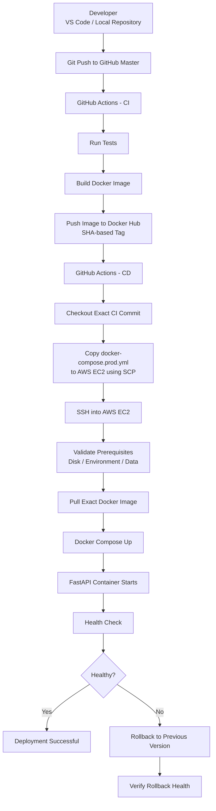

# CI/CD Deployment Architecture

## 1. Overview

The AI Trading Research Platform uses GitHub Actions to automate Continuous Integration (CI) and Continuous Deployment (CD).

The pipeline automatically tests the application, builds a Docker image, publishes it to Docker Hub, and deploys it to AWS EC2 using Docker Compose.

## 2. Architecture Diagram



## 3. CI Pipeline

The Continuous Integration workflow performs the following operations:

1. Detects code changes pushed to the master branch.
2. Checks out the source code.
3. Runs automated tests.
4. Builds the FastAPI Docker image.
5. Tags the image using the Git commit SHA.
6. Publishes the image to Docker Hub.

**Docker image repository:**

`rajnishk2439/ai-trading-api`

## 4. CD Pipeline

After successful CI execution, the Continuous Deployment workflow:

1. Checks out the exact commit built by CI.
2. Transfers `docker-compose.prod.yml` to the EC2 instance using SCP.
3. Connects to EC2 using SSH.
4. Validates deployment prerequisites.
5. Checks available disk space.
6. Validates the Docker Compose configuration.
7. Pulls the exact Docker image from Docker Hub.
8. Deploys the application using Docker Compose.
9. Verifies application health.
10. Attempts rollback if deployment fails.

## 5. Deployment Command

The CD workflow executes:

```bash
docker compose -f docker-compose.prod.yml \
  up -d --no-build --force-recreate
```

Docker Compose reads the production configuration and creates or recreates the FastAPI container.

## 6. Deployment Safety

The deployment process includes:

- SHA-based Docker image tagging.
- Deployment concurrency control.
- Disk-space validation.
- Environment and persistent-storage validation.
- Docker Compose configuration validation.
- Application health checks.
- Previous-version rollback handling.
- Docker image cleanup.

## 7. Technologies Used

| Technology | Purpose |
|---|---|
| Git | Source code management |
| GitHub | Source code repository |
| GitHub Actions | CI/CD automation |
| Docker | Application containerization |
| Docker Hub | Container image registry |
| Docker Compose | Container management |
| AWS EC2 | Production hosting |
| SSH | Remote deployment |
| SCP | Production configuration transfer |

## 8. Deployment Flow Summary

```text
Developer
   |
   v
GitHub Master
   |
   v
Continuous Integration
   |
   v
Docker Image Build
   |
   v
Docker Hub
   |
   v
Continuous Deployment
   |
   v
AWS EC2
   |
   v
Docker Compose
   |
   v
FastAPI Container
   |
   v
Health Verification
```
