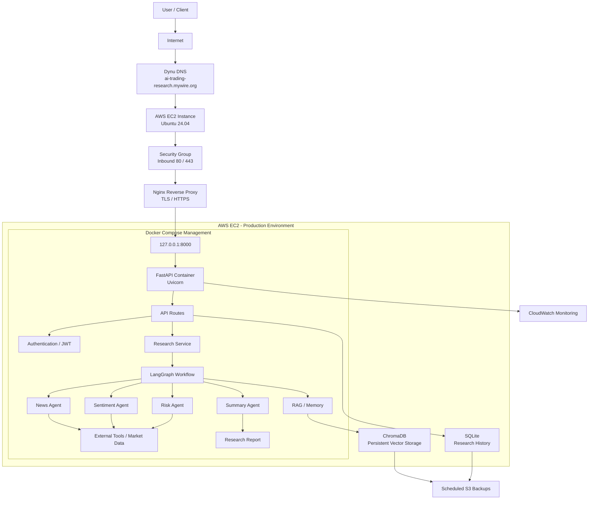

# Production Runtime Architecture

## 1. Overview

The AI Trading Research Platform is deployed on AWS EC2 using Docker Compose.

Users access the application through a custom domain over HTTPS. Nginx acts as a reverse proxy and forwards requests to the FastAPI application running inside a Docker container.

The backend executes a LangGraph-based research workflow and uses persistent storage for research history and vector-based memory.

## 2. Architecture Diagram



## 3. Infrastructure Components

### Domain and DNS

- Custom domain: `ai-trading-research.mywire.org`
- DNS provider: Dynu
- DNS resolves the domain to the EC2 public IP.

### AWS EC2

- Operating System: Ubuntu 24.04
- Hosts the production application.
- Runs Docker, Docker Compose and Nginx.

### Security Group

The intended inbound configuration is:

| Port | Protocol | Purpose |
|---|---|---|
| 22 | TCP | SSH administration |
| 80 | TCP | HTTP |
| 443 | TCP | HTTPS |
| 8000 | TCP | No public inbound rule intended |

### Nginx Reverse Proxy

Nginx handles incoming HTTP/HTTPS requests.

Responsibilities:

- Reverse proxy to FastAPI.
- HTTPS termination.
- HTTP to HTTPS redirection.
- Forward requests to `127.0.0.1:8000`.

### Docker Compose

Docker Compose manages the production FastAPI container.

Configuration file:

`docker-compose.prod.yml`

Responsibilities:

- Container lifecycle management.
- Image configuration.
- Environment variable injection.
- Port mapping.
- Persistent volume mounting.
- Restart policy.
- Container log rotation.

### FastAPI Backend

FastAPI provides the REST API endpoints.

Responsibilities:

- Handle incoming API requests.
- Authentication and authorization.
- Invoke research services.
- Return structured responses.

### LangGraph Research Workflow

The research workflow orchestrates the AI research process.

Logical workflow:

```text
User Query
    |
    v
News Agent
    |
    v
Sentiment Agent
    |
    v
Risk Agent
    |
    v
Summary Agent
    |
    v
Research Report
    |
    v
Memory Processing
```

### Persistent Storage

| Storage | Purpose |
|---|---|
| ChromaDB | Vector-based research memory |
| SQLite | User research history |

Host storage directory:

`/home/ubuntu/trading-api-data/`

Container storage paths:

- `/app/chroma_db`
- `/app/research_history.db`

### Monitoring and Backup

**CloudWatch**

- Infrastructure monitoring.
- CPU, memory and disk monitoring.
- Alarm notifications.

**Amazon S3**

- Scheduled application data backups.
- Backup storage outside the EC2 instance.

## 4. Production Network Flow

```text
User
  |
  v
Custom Domain
  |
  v
AWS EC2 Public IP
  |
  v
Nginx (HTTPS :443)
  |
  v
127.0.0.1:8000
  |
  v
FastAPI Docker Container
  |
  v
LangGraph Research Workflow
  |
  v
ChromaDB / SQLite
```

## 5. Persistent Data Management

The application uses host-mounted volumes to preserve data across container recreation.

```yaml
volumes:
  - /home/ubuntu/trading-api-data/chroma_db:/app/chroma_db
  - /home/ubuntu/trading-api-data/research_history.db:/app/research_history.db
```

This ensures that recreating the application container does not remove the persistent research data stored on the EC2 host.

## 6. Technologies Used

| Technology | Purpose |
|---|---|
| AWS EC2 | Production hosting |
| Ubuntu 24.04 | Operating system |
| Nginx | Reverse proxy |
| Let's Encrypt / Certbot | HTTPS certificates |
| Docker | Containerization |
| Docker Compose | Container management |
| FastAPI | Backend API |
| LangGraph | Agent orchestration |
| ChromaDB | Vector database |
| SQLite | Research history |
| CloudWatch | Monitoring |
| Amazon S3 | Backup storage |

## 7. Production Health Verification

Application health endpoint:

```text
https://ai-trading-research.mywire.org/health
```

Expected response:

```json
{
  "status": "healthy",
  "timestamp": "..."
}
```

The application is exposed through Nginx over HTTPS, while the FastAPI container is bound to localhost on port 8000.

## 8. Production Architecture Summary

The production environment follows a reverse-proxy-based deployment model.

Nginx handles external HTTPS traffic, Docker Compose manages the FastAPI container, LangGraph orchestrates the research workflow, and persistent storage maintains application data across deployments.

CloudWatch and Amazon S3 provide infrastructure monitoring and backup capabilities.
```
